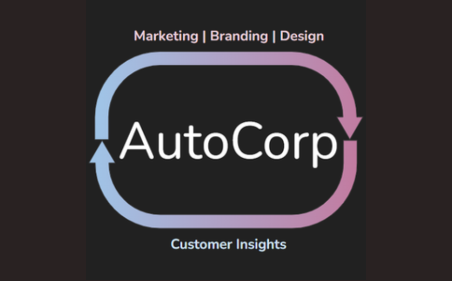

AutoCorp represents a pioneering vision for a fully autonomous company, powered by state-of-the-art Large Language Model agents. It was built by 
[Barry Zhang](https://www.linkedin.com/in/yijing-barry-zhang/), 
[Bruno Faviero](https://twitter.com/Bfaviero), 
[Donny Greenberg](https://www.linkedin.com/in/greenbergdon/), 
[Mina Fahmi](https://www.minafahmi.com/),
[Sergio Prada](https://www.linkedin.com/in/sergiopradamora/), 
and I during the NYC GPT/LLM Hackathon. The Large Language Model (GPT-4) functions as the core controller, producing reasoning traces and executing sequential actions.

AutoCorp generates a thesis for a direct-to-consumer t-shirt company based on a business owner’s initial idea. Subsequently, using an integrated system of GPT-4, DALL-E, and ControlNet, it crafts marketing, branding, and product design. As customers request customized t-shirts, AutoCorp promptly responds. Moreover, it continuously learns and refines its strategy based on customer feedback, updating its foundational thesis and all subsequent materials. This seamless flow has been demonstrated end-to-end, and can potentially be integrated with ad and custom t-shirt APIs for tangible real-world application. This demonstrates the possibility of a fully autonomous company that evolves towards an increasingly profitable business.

  <figure class="frame"></figure>
  
<iframe width="400" height="225" src="https://www.youtube.com/embed/xgmUpAJS1Nk" title="AutoCorp demo video" loading="lazy" allowfullscreen></iframe>

