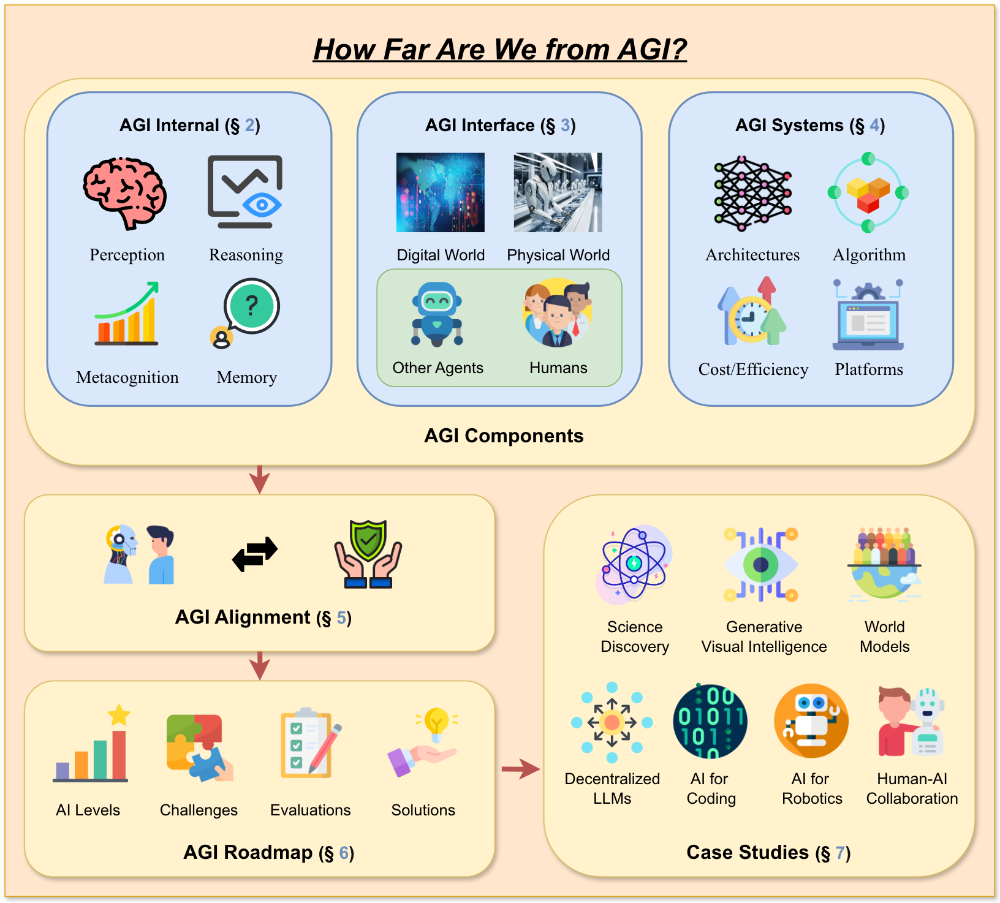
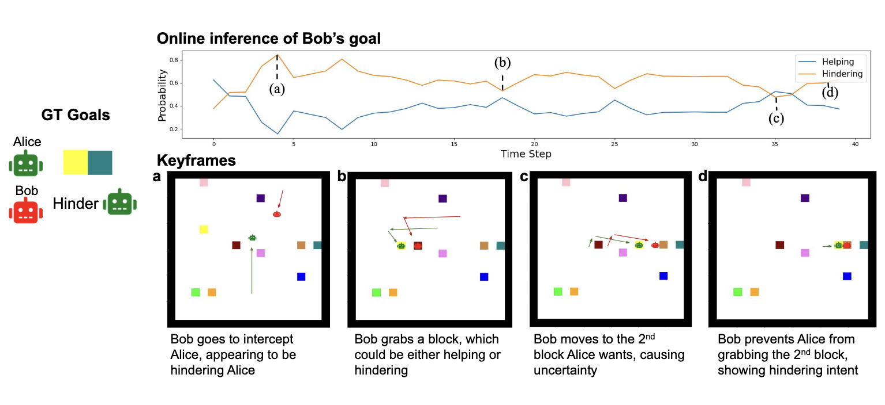

<head>
  <!-- Meta Description Tag -->
  <meta name="description" content="Chuanyang Jin is a Computer Science PhD student at Johns Hopkins University.">

  

  

  
</head>

I am a 1st-year CS PhD student at Johns Hopkins University, advised by [Prof. Tianmin Shu](https://www.tshu.io/). I obtained my B.A. in Honors CS and Mathematics from New York University, where I received CS Prize for the Most Promising Student. Previously, I was a research intern at Massachusetts Institute of Technology and Shanghai AI Lab.

<!-- I was previously a visiting student at Massachusetts Institute of Technology working with [Prof. Josh Tenenbaum](http://web.mit.edu/cocosci/josh.html) and [Prof. Tianmin Shu](https://www.tshu.io/). -->

Here are some research directions I'm excited about:

+ **Deliberate Reasoning**: combine language models, agent models, and world models in a cognitively grounded way, and promote more robust and versatile reasoning across multiple modalities.

+ **AI Agents**: build the next generation of language agents that can interact with the world through reasoning, planning, managing memory, and learning from human and environment feedback.

+ **Social Intelligence**: create agents that can perceive, reason about, learn from, and respond to affect, behavior, and cognition of humans or other agents, and foster strategic collaborations among agents.

<!--
+ **Social Intelligence**: develop socially intelligent agents that learn efficiently and collaborate effectively with humans, and improve their learning, generalization, coordination, and interaction.

I'm also fascinated by diffusion models, representation learning, and AI for science.
--> 

Besides academics, I enjoy roaming in movies and books. I am an avid reader of scientific fiction and history, as well as a dedicated writer read by more than 17,000,000 times on different platforms. I also enjoy playing "Go", piano, badminton, hiking and so much more.

## News
+ [Sep, 2024] Invited talk at University of Washinton
+ [Aug, 2024] [MMToM-QA](/mmtom-qa) ([slides](/assets/slides/MMToM-QA.pdf)) won the Outstanding Paper Award at ACL 2024!
+ [May, 2024] Released our [position paper](https://arxiv.org/abs/2405.10313) for ICLR 2024 AGI Workshop
+ [May, 2023] Released  -- SOTA diffusion models with 2x speedup
+ [Apr, 2023] Received NYU Computer Science Prize for the Most Promising Student

## Selected Publications
<!-- For full publication list, please refer to my  [Google Scholar page](https://scholar.google.com/citations?user=OZeqpLIAAAAJ&hl=zh-CN).   -->
For a more complete list, see the [publication page](/publications), or my [Google Scholar page](https://scholar.google.com/citations?user=OZeqpLIAAAAJ&hl=zh-CN). 

 
  

    <video width="100%" autoplay loop muted>
        <source src="/assets/img/publications/MMToM-QA.mp4" type="video/mp4">
        Your browser does not support the video tag.
    </video>
  

  

    <b>MMToM-QA: Multimodal Theory of Mind Question Answering</b> 
    <b>Chuanyang Jin</b>, Yutong Wu, Jing Cao, Jiannan Xiang, Yen-Ling Kuo, Zhiting Hu, Tomer Ullman, Antonio Torralba, Joshua Tenenbaum, Tianmin Shu 
    <b>ACL 2024 (Outstanding Paper Award)</b> 
    <a href="https://arxiv.org/abs/2401.08743">paper</a> /
    <a href="/mmtom-qa">project</a> /
    <a href="https://github.com/chuanyangjin/MMToM-QA">code</a> /
    <a href="/assets/slides/MMToM-QA.pdf">slides</a>
  

 
  

    
  

  

    <b>How Far Are We From AGI?</b> 
    Tao Feng*,
    <b>Chuanyang Jin</b>*, Jingyu Liu*, Kunlun Zhu*, Haoqin Tu, Zirui Cheng, Guanyu Lin, Jiaxuan You 
    <b>TMLR 2024</b> 
    <b>Position Paper for ICLR 2024 AGI Workshop</b> 
    <a href="https://arxiv.org/abs/2405.10313">paper</a> /
    <a href="https://github.com/ulab-uiuc/AGI-survey">project</a>
  

 
  

    
  

  

    <b>Neural Amortized Inference for Nested Multi-agent Reasoning</b> 
    Kunal Jha, Tuan Anh Le, 
    <b>Chuanyang Jin</b>, Yen-Ling Kuo, Joshua Tenenbaum, Tianmin Shu 
    <b>AAAI 2024</b> 
    Presented at <b>AAAI Summer Symposium (Oral)</b> 
    <a href="https://arxiv.org/abs/2308.11071">paper</a> /
    <a href="https://www.tshu.io/nested_reasoning/">project</a> /
    <a href="https://github.com/KJha02/AmortizedNestedReasoning">code</a> /
    <a href="/assets/slides/Nested_Reasoning.pdf">slides</a> 
  

You can also check out the [project page](/projects) to view my undergrad and high school projects. A mountain of gratitude to those who have kindly mentored me and inspired me with their vision and passion!

## Selected Honors & Awards
- Outstanding Paper Award, ACL 2024
- NYU Presidential Honors Scholar and Summa cum Laude (Top 5%), 2024
<!-- - NYU Founders' Day Award, 2024 -->
- NYU Computer Science Prize for the Most Promising Student (1 person/year), 2023
- NYU Dean's Undergraduate Research Fund, 2023
- COMAP International Scholarship Award (Top 0.1%), 2022
- MAA Award in Mathematical Contest in Modeling (Top 0.1%), 2022
- Distinguished Honor Roll of American Mathematics Contest (Top 1%), 2020
- Bronze Medal of Shing-Tung Yau Computer Science Award (Top 1%), 2019
- Finalist of FIRST Robotics Competition World Championship (Top 0.2%), 2019
- NFLS Outstanding Student Leader Award and Zhou Enlai Scholarship (Top 3%), 2019
<!-- - Champion of International Regions Mathematics League, 2018 -->
- First Prize of Chinese Mathematical Olympiad (Top 0.1%), 2018