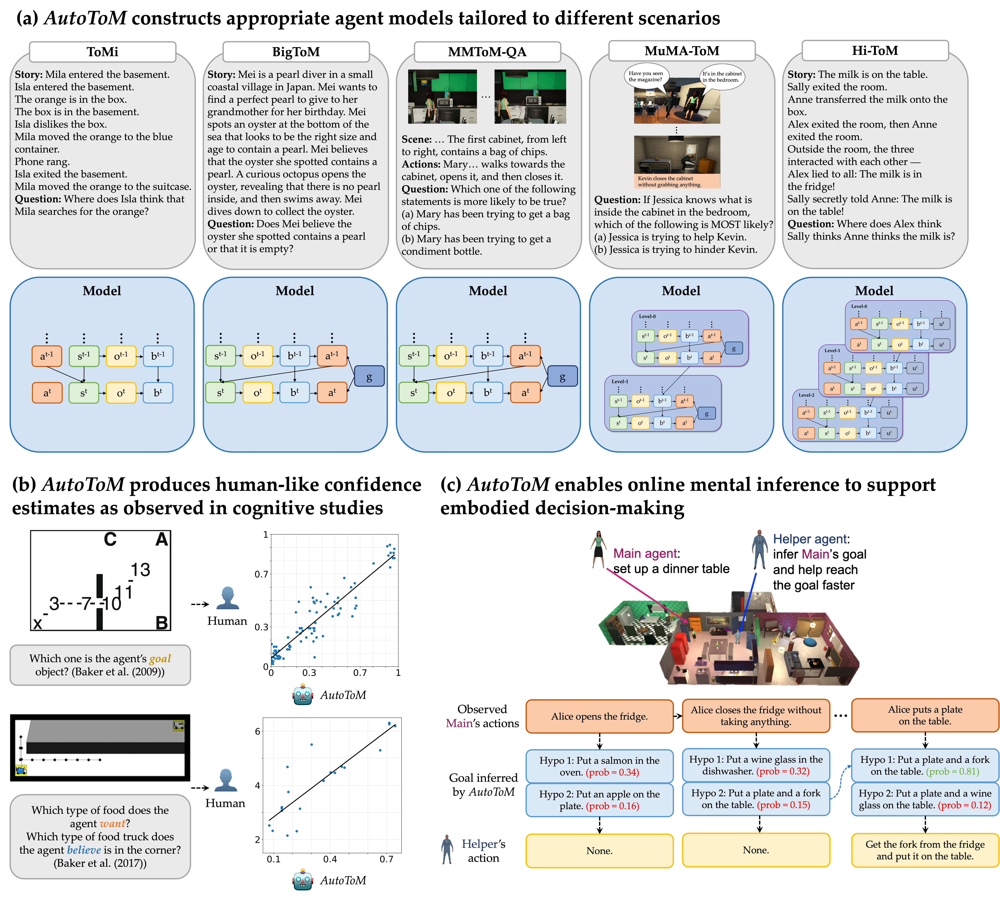
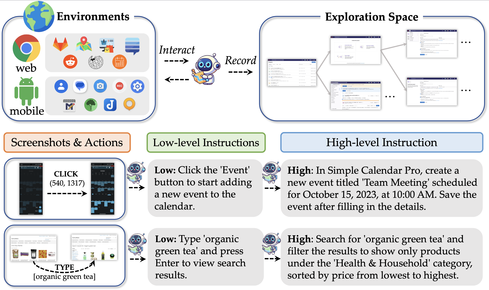
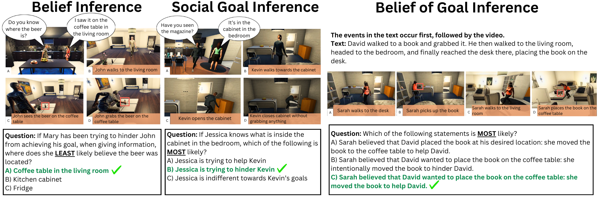

<head>
  <!-- Meta Description Tag -->
  <meta name="description" content="Chuanyang Jin is a Computer Science PhD student at Johns Hopkins University.">

  

  

  
</head>

I am a first-year Ph.D. student in Computer Science at [Johns Hopkins University](https://www.jhu.edu/), advised by [Tianmin Shu](https://www.tshu.io/). I'm also a research intern in the Fundamental AI Research (FAIR) team at Meta, mentored by [Jason Weston](https://ai.meta.com/people/1163645124801199/jason-weston/).

I received my B.A. in Honors Computer Science and B.A. in Mathematics from [New York University](https://www.nyu.edu/) in 2024, where I was awared the Computer Science Prize for the Most Promising Student. 
I have also spent time as a research intern at [MIT](https://www.mit.edu/). 
I received an Outstanding Paper Award at ACL 2024 for my work on [multimodal Theory of Mind](https://arxiv.org/abs/2401.08743).

I love working on exciting and game-changing research problems. My current areas of focus include:

+ **Social Intelligence**: Creating capable and friendly agents that can perceive, reason about, learn from, and respond to the behavior and cognition of humans or other agents; promoting strategic communication and collaboration among them.

+ **Advanced Reasoning**: Improving and integrating System-2 deliberate reasoning with System-1 intuitive thinking; combining language models, agent models, and world models in a scalable, cognitively grounded way.

<!-- + **Open-Ended Agents**: Building capable and friendly AI agents that can interact with humans and the world through reasoning, planning, managing memory, and learning from human and environment feedback. -->

Besides academics, I enjoy playing Go, piano, badminton, hiking, and [so much more](/misc).

## News
+ [Apr, 2025] Co-organizing the Workshop on [Continual Robot Learning from Humans](https://continual-robot-learning-from-humans.github.io/) at RSS 2025.
+ [Feb, 2025] Introducing [AutoToM](/AutoToM): an automated and SOTA Theory of Mind method ([Arxiv](https://arxiv.org/abs/2502.15676), [Twitter](https://x.com/chuanyang_jin/status/1894737913499246665)).
+ [Jan, 2025] [MuMA-ToM](https://scai.cs.jhu.edu/projects/MuMA-ToM/) was accepted at AAAI 2025 as an Oral Presentation!
+ [Oct, 2024] [MMToM-QA](/mmtom-qa) was covered by [Futurity](https://www.futurity.org/artificial-intelligence-theory-of-mind-3253282/), [Synced](https://mp.weixin.qq.com/s/fRa138rmFsv8W8JOYcsAPA), and [JHU News](https://engineering.jhu.edu/news/ai-cant-read-your-mind-yet/).
+ [Sep, 2024] Invited talk @ University of Washinton on "Towards Multimodal Theory of Mind".
+ [Aug, 2024] [MMToM-QA](/mmtom-qa) won the Outstanding Paper Award at ACL 2024!

<!-- 
+ [May, 2023] Released [fast-DiT](https://github.com/chuanyangjin/fast-DiT), state-of-the-art diffusion models with 2x speedup.
+ [Apr, 2023] Received [NYU Computer Science Prize](/assets/awards/NYU_Computer_Science_Prize.pdf) for the Most Promising Student. 
-->

## Selected Publications
(* denotes equal contribution; † denotes project lead) 
For a more complete list, please see my [publication page](/publications) or [Google Scholar page](https://scholar.google.com/citations?user=OZeqpLIAAAAJ&hl=zh-CN).  

 
  

    
  

  

    <b>AutoToM : Automated Bayesian Inverse Planning and Model Discovery for Open-ended Theory of Mind</b> 
    Zhining Zhang*,
    <b>Chuanyang Jin</b>*†, Mung Yao Jia*, Tianmin Shu 
    <b>Preprint</b> 
    <a href="https://arxiv.org/abs/2502.15676">paper</a> /
    <a href="/AutoToM">project</a> /
    <a href="https://github.com/SCAI-JHU/AutoToM">code</a>
  

 
  

    
  

  

    <b>OS-Genesis: Automating GUI Agent Trajectory Construction via Reverse Task Synthesis</b> 
    Qiushi Sun*, Kanzhi Cheng*, Zichen Ding*,
    <b>Chuanyang Jin</b>*, Yian Wang, Fangzhi Xu, Zhenyu Wu, Chengyou Jia, Liheng Chen, Zhoumianze Liu, Ben Kao, Guohao Li, Junxian He, Yu Qiao, Zhiyong Wu 
    <b>Preprint</b> 
    <a href="https://arxiv.org/abs/2412.19723">paper</a> /
    <a href="https://qiushisun.github.io/OS-Genesis-Home">project</a> /
    <a href="https://github.com/OS-Copilot/OS-Genesis">code</a>
  

 
  

    
  

  

    <b>MuMA-ToM: Multi-modal Multi-Agent Theory of Mind</b> 
    Haojun Shi*, Suyu Ye*, Xinyu Fang, 
    <b>Chuanyang Jin</b>, Leyla Isik, Yen-Ling Kuo, Tianmin Shu 
    <b>AAAI 2025 (Oral)</b> 
    <a href="https://arxiv.org/abs/2408.12574">paper</a> /
    <a href="https://scai.cs.jhu.edu/projects/MuMA-ToM/">project</a> /
    <a href="https://github.com/SCAI-JHU/MuMA-ToM">code</a>
  

 
  

    <video width="100%" autoplay loop muted>
        <source src="/assets/img/publications/MMToM-QA.mp4" type="video/mp4">
        Your browser does not support the video tag.
    </video>
  

  

    <b>MMToM-QA: Multimodal Theory of Mind Question Answering</b> 
    <b>Chuanyang Jin</b>, Yutong Wu, Jing Cao, Jiannan Xiang, Yen-Ling Kuo, Zhiting Hu, Tomer Ullman, Antonio Torralba, Joshua Tenenbaum, Tianmin Shu 
    <b>ACL 2024 (Outstanding Paper Award)</b> 
    <!-- Annual Meeting of the Association for Computational Linguistics (ACL), 2024 -->
    <a href="https://arxiv.org/abs/2401.08743">paper</a> /
    <a href="/mmtom-qa">project</a> /
    <a href="https://github.com/chuanyangjin/MMToM-QA">code</a> /
    <a href="/assets/slides/MMToM-QA.pdf">slides</a> /
    <a href="https://www.futurity.org/artificial-intelligence-theory-of-mind-3253282/">news</a>
  

 
  

    
  

  

    <b>How Far Are We From AGI?</b> 
    Tao Feng*,
    <b>Chuanyang Jin</b>*, Jingyu Liu*, Kunlun Zhu*, Haoqin Tu, Zirui Cheng, Guanyu Lin, Jiaxuan You 
    <!-- <b>TMLR 2024</b> 
    <b>ICLR 2024 AGI Workshop (Oral)</b>  -->
    <b>TMLR 2024</b> / <b>ICLR 2024 AGI Workshop (Oral)</b> 
    <a href="https://arxiv.org/abs/2405.10313">paper</a> /
    <a href="https://github.com/ulab-uiuc/AGI-survey">project</a>
  

<!-- 
 
  

    
  

  

    <b>Neural Amortized Inference for Nested Multi-agent Reasoning</b> 
    Kunal Jha, Tuan Anh Le, 
    <b>Chuanyang Jin</b>, Yen-Ling Kuo, Joshua Tenenbaum, Tianmin Shu 
    <b>AAAI 2024</b> 
    Presented at <b>AAAI Summer Symposium (Oral)</b> 
    <a href="https://arxiv.org/abs/2308.11071">paper</a> /
    <a href="https://www.tshu.io/nested_reasoning/">project</a> /
    <a href="https://github.com/KJha02/AmortizedNestedReasoning">code</a> /
    <a href="/assets/slides/Nested_Reasoning.pdf">slides</a> 
  

 -->

You can also take a look at [my undergrad projects](/projects). A mountain of gratitude to those who have kindly mentored me and inspired me with their vision and passion!

## Selected Honors & Awards
- ICLR Notable Reviewer, 2025
- ACL Outstanding Paper Award, 2024
- NYU Presidential Honors Scholar and Summa cum Laude (Top 5%), 2024
- NYU Computer Science Prize for the Most Promising Student (1 person/year), 2023
- NYU Dean's Undergraduate Research Fund, 2023
- COMAP International Scholarship Award (Top 0.1%), 2022
- MAA Award in Mathematical Contest in Modeling (Top 0.1%), 2022
<!-- - Distinguished Honor Roll of American Mathematics Contest (Top 1%), 2020 -->
- Bronze Medal of Shing-Tung Yau Computer Science Award (Top 1%), 2019
- Finalist of FIRST Robotics Competition World Championship (Top 0.2%), 2019
- NFLS Outstanding Student Leader Award and Zhou Enlai Scholarship (Top 1%), 2018
<!-- - Champion of International Regions Mathematics League, 2018 -->
- First Prize of Chinese Mathematical Olympiad (Top 0.1%), 2018