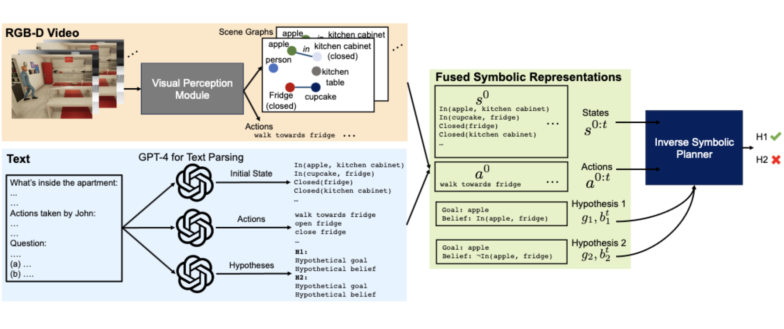
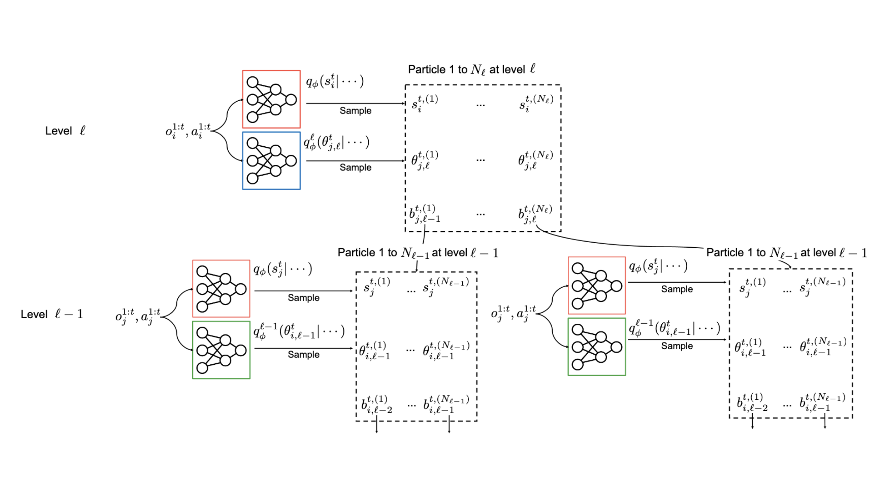
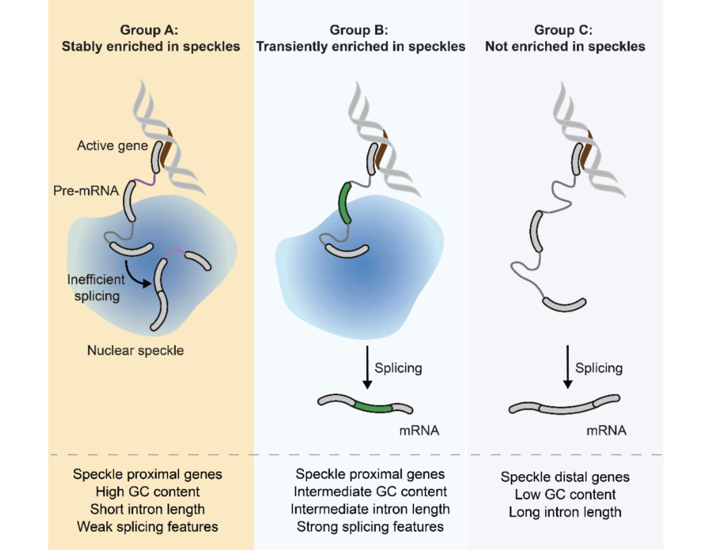
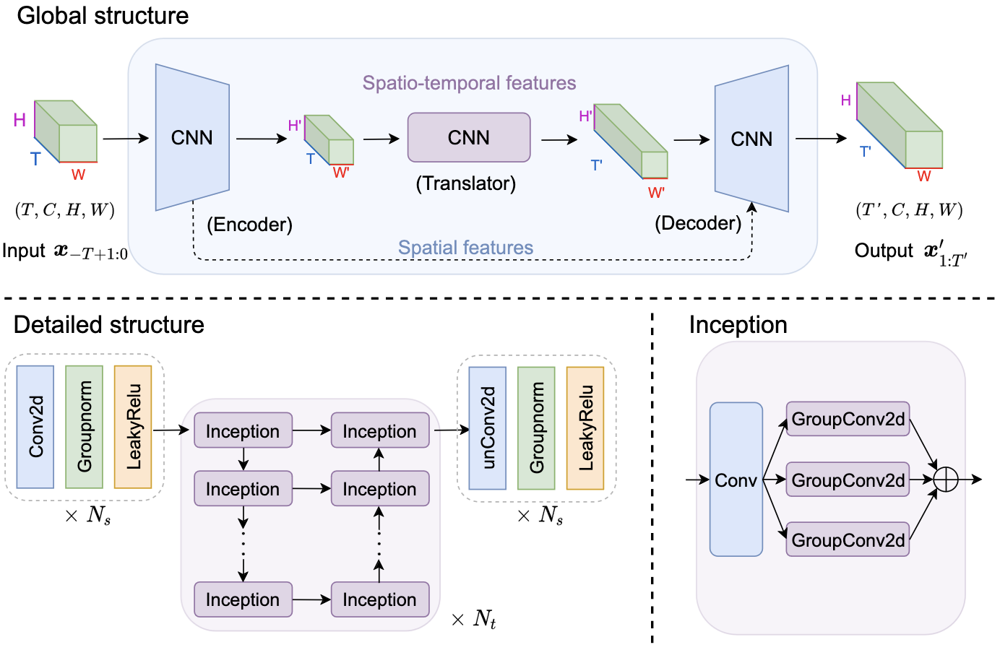
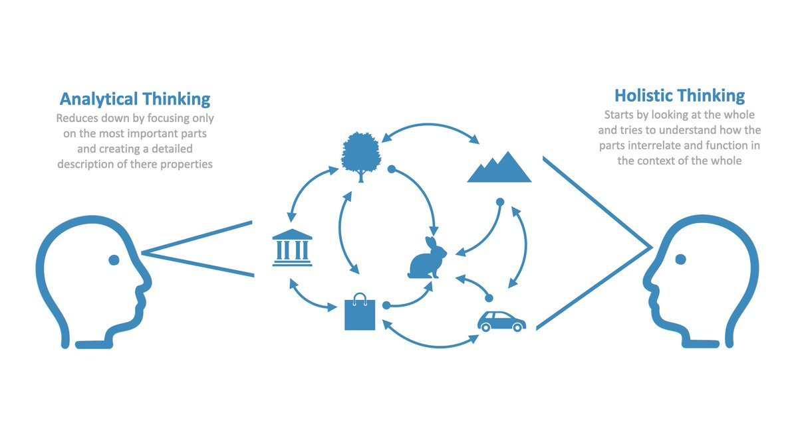
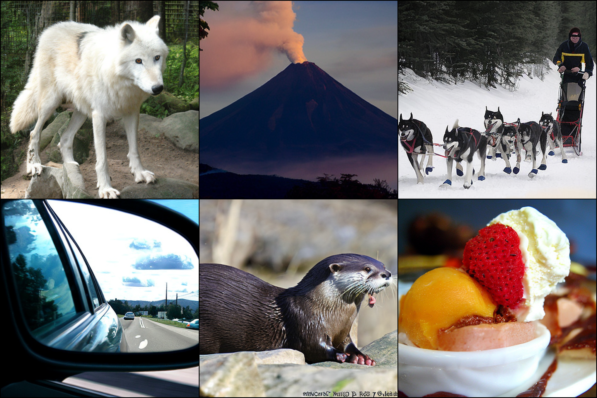
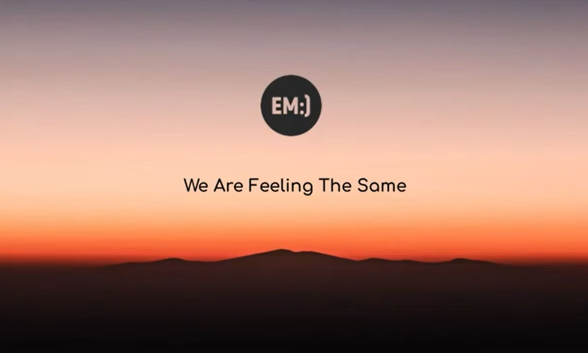

<head>
  <!-- Meta Description Tag -->
  <meta name="description" content="Chuanyang Jin is a visiting student at MIT advised by Prof. Josh Tenenbaum, Prof. Antonio Torralba, and Prof. Tianmin Shu. Currently, Chuanyang Jin is a senior student in Honors Computer Science and Mathematics at NYU Courant.">

  
</head>

I am a visiting student at MIT advised by [Prof. Josh Tenenbaum](http://web.mit.edu/cocosci/josh.html), [Prof. Antonio Torralba](https://groups.csail.mit.edu/vision/torralbalab/), and [Prof. Tianmin Shu](https://www.tshu.io/). Currently, I am a senior student in Honors Computer Science and Mathematics at NYU Courant, where I'm fortunate to work with [Prof. Oded Regev](https://cims.nyu.edu/~regev/), [Prof. Saining Xie](https://www.sainingxie.com/) and [Prof. He He](https://hhexiy.github.io/).

I am broadly interested in Natural Language Processing and Computer Vision. Here are some directions I’m particularly excited about:

+ **Foundation Models**: enhance the robustness, truthfulness, and instruction-adherence of foundation models through diverse experiences (e.g., data instances, structured knowledge, embodied experiences).

+ **Embodied AI**: leverage foundation models to build embodied agents capable of *long-term* decision making through planning, reasoning, managing memory, and learning from human and environment feedback.

+ **Social Intelligence**: develop socially intelligent systems that master commonsense knowledge, and combine it with new knowledge and skills, so they learn efficiently and collaborate effectively with humans.

<!--
leverage models to 

+ **Decision Making in Real World**: leverage foundation models to build agents capable of *long-term* decision making through effective planning, reasoning, managing memory, and learning from real-world feedback.

+ **Social Intelligence**: develop socially intelligent systems that learns causality and commonsense knowledge, so that they can confidently understand, reason about, and collaborate with humans.
+ **Instruction Tuning**: advance instruction tuning methods and constructs general-purpose instruction-following models
+ **Human-AI collaboration**: construct intelligent systems that communicate and collaborate effectively with humans, and endow them with social intelligence and social commonsense.
+ **Generative intelligence**: design generative models that assist humans in the effortless creation of visual data (e.g., images, videos, 3D data, and multimodal data).

I'm also fascinated by diffusion models, representation learning, and AI for science.

 prevent certain parts from being displayed in the snippet in Google's search results 
--> 

Besides academics, I enjoy roaming in movies and books. I am an avid reader of history and scientific fiction, as well as a dedicated writer read by more than 16,000,000 times on different platforms. I also enjoy playing "Go", piano, badminton, and hiking. 

Here is my [CV](/assets/Chuanyang_CV.pdf) (Last update: Dec 2023).

## News
+ [Dec, 2023] I'm attending NeurIPS 2023. Feel free to reach out if you'd like to have a chat!
<!-- + [Dec, 2023] One paper accepted to AAAI 2024 -->
+ [July, 2023] Presented [our work](/assets/slides/AAAI_Nested_Reasoning.pdf) at AAAI Summer Symposium 2023
+ [May, 2023] I am joining MIT Cocosci and CSAIL as a visiting student
+ [May, 2023]  released -- SOTA diffusion models with 2x speedup
+ [Apr, 2023] Received [NYU Computer Science Prize](/assets/Computer_Science_Prize.pdf) as the top 1 out of 375 students
+ [May, 2022] Received [COMAP Scholarship](https://contest.comap.com/undergraduate/contests/mcm/contests/2022/results/2022_COMAP-Scholarship-Press-Release.pdf) as the top 4 out of 27,205 teams in MCM

## Research

 
  

    
  

  

    <b>MMToM-QA: Multimodal Theory of Mind Question Answering</b> 
    <b>Chuanyang Jin</b>,
    <a href="https://www.linkedin.com/in/yutong-wu-a5a575209/">Yutong Wu</a>,
    <a href="https://www.linkedin.com/in/jingcao26/">Jing Cao</a>,
    <a href="https://szxiangjn.github.io/">Jiannan Xiang</a>,
    <a href="https://yenlingkuo.com/">Yen-Ling Kuo</a>,
    <a href="http://zhiting.ucsd.edu/">Zhiting Hu</a>,
    <a href="https://www.tomerullman.org/">Tomer Ullman</a>,
    <a href="https://groups.csail.mit.edu/vision/torralbalab/">Antonio Torralba</a>,
    <a href="http://web.mit.edu/cocosci/josh.html">Joshua Tenenbaum</a>,
    <a href="https://www.tshu.io/">Tianmin Shu</a> 
    <i>Under Review</i>  
    A short version presented at <a href="https://sites.google.com/view/fmdm-neurips23/">NeurIPS'23 FMDM Workshop</a>.  
    <a href="https://arxiv.org/abs/2401.08743">paper</a> /
    <a href="/mmtom-qa">project</a> /
    <a href="https://github.com/chuanyangjin/MMToM-QA">code</a> /
    <a href="http://virtual-home.org/release/MMToMQA/benchmark.zip">benchmark</a> /
    <a href="https://x.com/chuanyang_jin/status/1748336997532315756?s=20">tweet</a>
  

 
  

    
  

  

    <b>Neural Amortized Inference for Nested Multi-agent Reasoning</b> 
    <a href="https://www.linkedin.com/in/kunal-jha-5728b8182/">Kunal Jha</a>, 
    <a href="https://www.tuananhle.co.uk/">Tuan Anh Le</a>, 
    <b>Chuanyang Jin</b>, 
    <a href="https://yenlingkuo.com/">Yen-Ling Kuo</a>, 
    <a href="http://web.mit.edu/cocosci/josh.html">Joshua Tenenbaum</a>,
    <a href="https://www.tshu.io/">Tianmin Shu</a> 
    <i>AAAI 2024</i>  
    Oral Presentation at AAAI Summer Symposium, 2023.  
    <a href="https://arxiv.org/abs/2308.11071">paper</a> /
    <a href="https://www.tshu.io/nested_reasoning/">project</a> /
     <a href="/assets/slides/AAAI_Nested_Reasoning.pdf">slides</a> /
    <a href="https://www.tshu.io/nested_reasoning/Nested_Reasoning_Supplementary.pdf">supp</a>
  

 
  

    
  

  

    <b>Deciphering RNA Localization in Nuclear Speckles</b> 
    <a href="https://feilab.uchicago.edu/group.html">Jinjun Wu*</a>,
    <a href="https://feilab.uchicago.edu/group.html">Yu Xiao*</a>, 
    <a href="https://feilab.uchicago.edu/group.html">Yunzheng Liu*</a>,
    <a href="https://feilab.uchicago.edu/group.html">Li Wen</a>, 
    <b>Chuanyang Jin</b>,
    <a href="https://scholar.google.com/citations?user=zwZ8k9gAAAAJ&hl=zh-CN">Shun Liu</a>, 
    <a href="https://feilab.uchicago.edu/group.html">Sneha Paul</a>, 
    <a href="https://he-group.uchicago.edu/">Chuan He</a>, 
    <a href="https://cims.nyu.edu/~regev/">Oded Regev</a>, 
    <a href="https://feilab.uchicago.edu/group.html">Jingyi Fei</a> 
    <i>Under Review</i> 
  

 
  

    
  

  

    <b>Self-Supervised Image Captioning with CLIP</b> 
    <b>Chuanyang Jin</b> 
    <i>NeurIPS’23 Self-Supervised Learning Workshop</i> 
    <a href="https://arxiv.org/abs/2306.15111">paper</a>
  

 
  

    
  

  

    <b>Efficient Video Prediction and Segmentation with Sparse Labeled Data</b> 
    <a href="https://www.linkedin.com/in/peiqi-liu-2a40901b6/">Peiqi Liu</a>,
    <b>Chuanyang Jin</b>,
    <a href="https://samzhong0702.github.io/">Samuel Zhong</a> 
    <i>Under Review</i> 
  

 
  

    
  

  

    <b>The Cultural Psychology of Large Language Models: Is ChatGPT a Holistic or Analytic Thinker?</b> 
    <b>Chuanyang Jin*</b>, 
    <a href="https://www.linkedin.com/in/songyang-zhang-306956185/">Songyang Zhang*</a>, 
    <a href="https://www.tshu.io/">Tianmin Shu</a>,
    <a href="https://zhihan-cui.weebly.com/">Zhihan Cui</a> 
    <i>Under Review</i> 
    <a href="https://arxiv.org/abs/2308.14242">paper</a>
  

## Projects

 
  

    
  

  

    <b>Optimization of Diffusion Transformers</b> 
    SOTA diffusion models with 2x speedup, 250+ GitHub Stars.  
    Advised by <a href="https://www.sainingxie.com/">Prof. Saining Xie</a>.  
    <a href="/assets/reports/Optimizing_Diffusion_Transformers.pdf">report</a> / 
    <a href="https://github.com/chuanyangjin/fast-DiT">project</a>
  

 
  

    
  

  

    <b>AutoCorp: A Fully Autonomous Company</b> 
    NYC GPT/LLM Hackathon 2023 
    LLM-driven autonomous company, 120k+ Twitter views. 
    <a href="/autocorp">demo</a> / 
    <a href="https://twitter.com/minafahmi_/status/1650861037737091083">tweet</a> / 
    <a href="https://github.com/Czechh/chatdtc">code</a>
  

 
  

    
  

  

    <b>AutoLink: A Tool for Strategic Networking</b> 
    Hack GPT 2023 
    <a href="https://devpost.com/software/learn-and-link">demo</a> / 
    <a href="https://github.com/chuanyangjin/Learn_and_Link">code</a>
  

 
  

    
  

  

    <b>Class Embedding Patterns in Classifier-Free Diffusion</b> 
    Course Project in CSCI-GA 2565 Machine Learning (Grad-level) 
    <a href="/assets/reports/Class_Embedding_Patterns_in_Classifier-Free_Diffusion.pdf">report</a> / 
    <a href="/assets/slides/Class_Embedding_Patterns_in_Classifier-Free_Diffusion.pdf">slides</a> / 
    <a href="https://github.com/chuanyangjin/DDPM-with-Class-Embeddings">code</a>
  

 
  

    
  

  

    <b>Recommendation System for E-commerce Retailer</b> 
    NYU x Peak Datathon 2022 
    <a href="/assets/slides/Recommendation_System_for_Olist_E-commerce_Retailer.pdf">slides</a> / 
    <a href="https://github.com/chuanyangjin/Peak-Datathon">code</a>
  

 
  

    
  

  

    <b>Social Platform for Recording and Sharing Emotions</b> 
    HackNYU 2022 
    <a href="https://devpost.com/software/em-k3gf5b">demo</a> / 
    <a href="https://github.com/chuanyangjin/em">code</a>
  

 
  

    
  

  

    <b>Promoting Global Equity through Asteroid Mining</b> 
    Interdisciplinary Contest in Modeling 2022 
    Awards: Finalist & MAA Award (Top 5/27205) &  
    <a href="https://contest.comap.com/undergraduate/contests/mcm/contests/2022/results/2022_COMAP-Scholarship-Press-Release.pdf">COMAP Scholarship</a> (Top 4/27205, $10,000) 
    <a href="/assets/reports/ICM_Report.pdf">report</a>
  

 
  

    
  

  

    <b>Gene Mutation Detection System</b> 
    Shing-Tung Yau Computer Science Award Global Finals 2019 
    Award: <a href="http://www.yau-awards.com/lists-winnerslist.html">International Bronze Award</a> (Top 3/500, $10,000) 
    Our system was adopted by leading hospitals. 
    <a href="https://drive.google.com/file/d/1Zdp33tiYmoppAdzMCOH_P44jzu6V9yW-/view?usp=sharing">demo</a> / 
    <a href="https://oss.linstitute.net/wechatimg/2019/12/qiuchengtong2019combronze3.pdf">report</a> /
    <a href="/assets/slides/Yau_Gene_Mutation_Detection.pdf">slides</a>
  

### Course Projects

+ [Energy-Based Models for Structured Prediction](https://github.com/chuanyangjin/NYU-Course-Projects/blob/master/Energy-Based%20Models%20for%20Structured%20Prediction/Energy-Based%20Models%20for%20Structured%20Prediction.ipynb)

+ [Parallel Data Encoding](https://github.com/chuanyangjin/NYU-Course-Projects/tree/master/Parallel%20Data%20Encoding)

+ [Robot Intelligence](https://github.com/chuanyangjin/NYU-Course-Projects/tree/master/Robot%20Intelligence)

+ [Transformer-based German-English Translator](https://github.com/chuanyangjin/NYU-Course-Projects/tree/master/Transformer-based%20German-English%20Translator)

+ [Unix Shell Implementation](https://github.com/chuanyangjin/NYU-Course-Projects/tree/master/Unix%20Shell%20Implementation)

+ [Vision Transformer for Small-Size Datasets](https://github.com/chuanyangjin/NYU-Course-Projects/tree/master/Vision%20Transformer%20for%20Small-Size%20Datasets)

+ [YOLO Object Detection](https://github.com/chuanyangjin/NYU-Course-Projects/blob/master/YOLO%20Object%20Detection/YOLO%20Object%20Detection.ipynb)

And 8 others... [see more](https://github.com/chuanyangjin/NYU-Course-Projects)