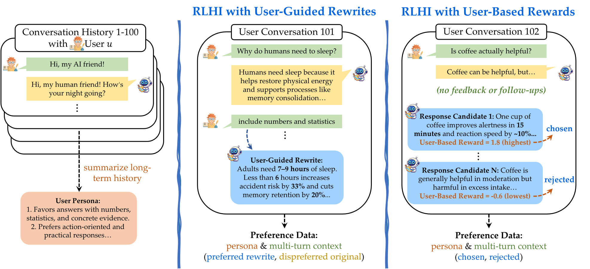

<head>
  <!-- Meta Description Tag -->
  <meta name="description" content="Chuanyang Jin is a Computer Science PhD student at Johns Hopkins University.">

  
</head>

I am a 2nd-year Ph.D. student in Computer Science at [Johns Hopkins University](https://www.jhu.edu/), advised by [Tianmin Shu](https://www.tshu.io/). I'm also a part-time student researcher at Meta FAIR, mentored by [Jason Weston](https://ai.meta.com/people/1163645124801199/jason-weston/).

I received bachelor degrees in Honors Computer Science and Mathematics from [New York University](https://www.nyu.edu/) (2020-2024), where I was awarded the Computer Science Prize for the Most Promising Student.
I was as a research intern at [MIT](https://www.mit.edu/) (2023), advised by [Josh Tenenbaum](https://web.mit.edu/cocosci/josh.html).
I received an Outstanding Paper Award at ACL 2024 for my work on [multimodal Theory of Mind](https://arxiv.org/abs/2401.08743).
<!-- I have spent time as a research intern at [MIT](https://www.mit.edu/) (2023), advised by [Josh Tenenbaum](https://web.mit.edu/cocosci/josh.html). -->

I’m interested in developing AI systems with *advanced social intelligence (ASI)*. My current areas of focus include:
<!-- I love working on exciting and game-changing research problems. -->
<!-- social reasoning, social learning -->

 <strong>Reasoning about Human Interaction</strong>: Building AI that can continuously perceive, reason about, and respond to human behavior and cognition.

  <ul>
  <li> We all want our AI to understand us. My research addresses this through a model-based approach, developing agent models that capture human behavior and infer mental states (e.g., goals, beliefs, desires) from observations (e.g., speech, motion).
  </li>
  <li> In particular, my works automate agent modeling with LLM backends, advancing Theory of Mind reasoning by <a href="https://chuanyangjin.com/mmtom-qa">grounding it in cognitive theories</a>, learning from <a href="https://chuanyangjin.com/mmtom-qa">multi-modal</a>, <a href="https://scai.cs.jhu.edu/projects/MuMA-ToM/">multi-agent</a> and <a href="https://arxiv.org/abs/2506.23046">multi-perspective</a> observations, and <a href="https://chuanyangjin.com/AutoToM/">scaling to long-term and complex settings</a>.
  </li>
  </ul>

 <strong>Learning from Human Interaction</strong>: Building AI that continuously learns from real-world human interactions.

<!-- Building AI that continuously learns from human interactions—either through demonstrations, communications, feedback, or collaboration. -->

  <ul>
  <li> We advocate for an <a href="https://arxiv.org/abs/2509.25137">era of real-world human interaction</a> that learns from real users' diverse goals and preferences, adapts to situational demands, and scales with actual usage. We introduce <a href="https://arxiv.org/abs/2509.25137">Reinforcement Learning from Human Interaction (RLHI)</a>, which learns directly from user conversations and outperforms RLHF at the user level. </li>
  <li> I initiated <a href="https://continual-robot-learning-from-humans.github.io/">RSS Workshop on Continual Robot Learning from Humans</a>. </li>
  </ul>

Besides academics, I enjoy playing Go, piano, badminton, hiking, and [so much more](/misc).

<!-- 

Developing AI systems that continuously perceive, reason about, and respond to human behavior and cognition.

+ **Social Intelligence**: Creating capable and friendly agents that can perceive, reason about, learn from, and respond to the behavior and cognition of humans or other agents; promoting strategic communication and collaboration among them.

+ **Advanced Reasoning**: Improving and integrating System-2 deliberate reasoning with System-1 intuitive thinking; combining language models, agent models, and world models in a scalable, cognitively grounded way.

+ **Open-Ended Agents**: Building capable and friendly AI agents that can interact with humans and the world through reasoning, planning, managing memory, and learning from human and environment feedback. -->

## News
+ [Oct, 2025] Honored to receive the Amazon PhD Fellowship!
+ [Oct, 2025] Invited talk @ Google on [RLHI](https://arxiv.org/abs/2509.25137).
+ [Sep, 2025] [AutoToM](/AutoToM) is accepted by NeurIPS 2025 as a Spotlight Presentation!
+ [June, 2025] Co-organized the Workshop on [Continual Robot Learning from Humans](https://continual-robot-learning-from-humans.github.io/) at RSS 2025.
+ [June, 2025] I was selected as a Notable Reviwer for ICLR 2025.
+ [Jan, 2025] [MuMA-ToM](https://scai.cs.jhu.edu/projects/MuMA-ToM/) is accepted by AAAI 2025 as an Oral Presentation!
+ [Sep, 2024] Invited talk @ University of Washinton on "Towards Multimodal Theory of Mind".
+ [Aug, 2024] [MMToM-QA](/mmtom-qa) won the Outstanding Paper Award at ACL 2024! It was also covered by [Futurity](https://www.futurity.org/artificial-intelligence-theory-of-mind-3253282/), [Synced](https://mp.weixin.qq.com/s/fRa138rmFsv8W8JOYcsAPA), and [JHU News](https://engineering.jhu.edu/news/ai-cant-read-your-mind-yet/).

<!-- 
+ [May, 2023] Released [fast-DiT](https://github.com/chuanyangjin/fast-DiT), state-of-the-art diffusion models with 2x speedup.
+ [Apr, 2023] Received [NYU Computer Science Prize](/assets/awards/NYU_Computer_Science_Prize.pdf) for the Most Promising Student. 
-->

<!-- ## Selected Publications -->
## Recent Publications
(* denotes equal contribution; † denotes project lead) 
For a more complete list, please see my [publication page](/publications) or [Google Scholar page](https://scholar.google.com/citations?user=OZeqpLIAAAAJ&hl=zh-CN).  

 
  

    
  

  

     The Era of Real-World Human Interaction: RL from User Conversations 
    <b>Chuanyang Jin</b>, Jing Xu, Bo Liu, Leitian Tao, Olga Golovneva, Tianmin Shu, Wenting Zhao, Xian Li, Jason Weston 
    <b>arXiv Preprint (Invited Talk at Google; Paper of the Week by Huggingface/DAIR.AI/TuringPost)</b> 
    <a href="https://arxiv.org/abs/2509.25137">paper</a> / 
    <a href="https://x.com/jaseweston/status/1972851921255051489">tweet</a>
    
      Reinforcement Learning from Human Interaction (RLHI) learns directly from real-world user conversations, beating RLHF at the user level and enabling personalized, contextual, and continually improving AI assistants.
    
  

 
  

    
  

  

     AutoToM: Scaling Model-based Mental Inference via Automated Agent Modeling 
    Zhining Zhang*, <b>Chuanyang Jin</b>*†, Mung Yao Jia*, Shunchi Zhang*, Tianmin Shu (†: project lead) 
    <b>NeurIPS 2025 (Spotlight)</b> 
    <a href="https://arxiv.org/abs/2502.15676">paper</a> /
    <a href="/AutoToM">project</a> /
    <a href="https://github.com/SCAI-JHU/AutoToM">code</a>
    
      AutoToM is an automated agent modeling method for scalable, robust, and interpretable mental inference. It achieves SOTA on five benchmarks, produces human-like confidence estimates, and supports embodied decision-making.
    
  

 
  

    
  

  

     OS-Genesis: Automating GUI Agent Trajectory Construction via Reverse Task Synthesis 
    Qiushi Sun*, Kanzhi Cheng*, Zichen Ding*, <b>Chuanyang Jin</b>*, Yian Wang, Fangzhi Xu, Zhenyu Wu, Chengyou Jia, Liheng Chen, Zhoumianze Liu, Ben Kao, Guohao Li, Junxian He, Yu Qiao, Zhiyong Wu 
    <b>ACL 2025 (Huggingface Daily Papers Top-1)</b> 
    <a href="https://arxiv.org/abs/2412.19723">paper</a> /
    <a href="https://qiushisun.github.io/OS-Genesis-Home">project</a> /
    <a href="https://github.com/OS-Copilot/OS-Genesis">code</a> /
    <a href="https://huggingface.co/collections/OS-Copilot/os-genesis-6768d4b6fffc431dbf624c2d">model</a> /
    <a href="https://huggingface.co/collections/OS-Copilot/os-genesis-6768d4b6fffc431dbf624c2d">data</a> /
    <a href="/assets/slides/OS-Genesis.pdf">slides</a>
    
      OS-Genesis enables agents to actively explore web and mobile environments, facilitating the self-collection and self-annotation of high-quality training data.
    
  

 
  

    
  

  

     MuMA-ToM: Multi-modal Multi-Agent Theory of Mind 
    Haojun Shi*, Suyu Ye*, Xinyu Fang, <b>Chuanyang Jin</b>, Leyla Isik, Yen-Ling Kuo, Tianmin Shu 
    <b>AAAI 2025 (Oral)</b> 
    <a href="https://arxiv.org/abs/2408.12574">paper</a> /
    <a href="https://scai.cs.jhu.edu/projects/MuMA-ToM/">project</a> /
    <a href="https://github.com/SCAI-JHU/MuMA-ToM">code</a> /
    <a href="https://huggingface.co/datasets/SCAI-JHU/MUMA-TOM-BENCHMARK">benchmark</a> / 
    <a href="https://scai.cs.jhu.edu/projects/MuMA-ToM/leaderboard.html">leaderboard</a> /
    <a href="/assets/slides/MuMA-ToM.pdf">slides</a>
    
      MuMA-ToM introduces a benchmark and method that extend MMToM-QA to multi-agent interaction scenarios.
    
  

 
  

    <video width="100%" autoplay loop muted>
        <source src="/assets/img/publications/MMToM-QA.mp4" type="video/mp4">
        Your browser does not support the video tag.
    </video>
  

  

     MMToM-QA: Multimodal Theory of Mind Question Answering 
    <b>Chuanyang Jin</b>, Yutong Wu, Jing Cao, Jiannan Xiang, Yen-Ling Kuo, Zhiting Hu, Tomer Ullman, Antonio Torralba, Joshua Tenenbaum, Tianmin Shu 
    <b>ACL 2024 (Outstanding Paper Award)</b> 
    <a href="https://arxiv.org/abs/2401.08743">paper</a> /
    <a href="/mmtom-qa">project</a> /
    <a href="https://github.com/chuanyangjin/MMToM-QA">code</a> /
    <a href="https://github.com/chuanyangjin/MMToM-QA?tab=readme-ov-file#-mmtom-qa-benchmark">benchmark</a> /
    <a href="https://chuanyangjin.com/mmtom-qa-leaderboard">leaderboard</a> /
    <a href="/assets/slides/MMToM-QA.pdf">slides</a> /
    <a href="https://www.futurity.org/artificial-intelligence-theory-of-mind-3253282/">Futurity news</a> /
    <a href="https://engineering.jhu.edu/news/ai-cant-read-your-mind-yet/">JHU news</a> 
    
      Can machines understand people's minds from multimodal inputs? MMToM-QA introduces the first benchmark and a promising method that combines the flexibility of LLMs with the robustness of Bayesian inverse planning.
    
  

<!-- 
 
  

    
  

  

     How Far Are We From AGI? 
    Tao Feng*, <b>Chuanyang Jin</b>*, Jingyu Liu*, Kunlun Zhu*, Haoqin Tu, Zirui Cheng, Guanyu Lin, Jiaxuan You 
    <b>TMLR 2024</b> / <b>ICLR 2024 AGI Workshop (Oral)</b> 
    <a href="https://arxiv.org/abs/2405.10313">paper</a> /
    <a href="https://github.com/ulab-uiuc/AGI-survey">project</a>
    
      We offer comprehensive analysis and novel insights into potential pathways toward AGI.
    
  

 -->

<!-- 
 
  

    
  

  

    <b>Neural Amortized Inference for Nested Multi-agent Reasoning</b> 
    Kunal Jha, Tuan Anh Le, 
    <b>Chuanyang Jin</b>, Yen-Ling Kuo, Joshua Tenenbaum, Tianmin Shu 
    <b>AAAI 2024</b> 
    Presented at <b>AAAI Summer Symposium (Oral)</b> 
    <a href="https://arxiv.org/abs/2308.11071">paper</a> /
    <a href="https://www.tshu.io/nested_reasoning/">project</a> /
    <a href="https://github.com/KJha02/AmortizedNestedReasoning">code</a> /
    <a href="/assets/slides/Nested_Reasoning.pdf">slides</a> 
  

 -->

Feel free to check out [my undergrad projects](/projects). A mountain of gratitude to those who have kindly mentored and inspired me with their vision and passion!

## Selected Honors & Awards
- Amazon PhD Fellowship, 2025
- Notable Reviewer, ICLR 2025
- Outstanding Paper Award, ACL 2024
- Presidential Honors Scholar and Summa cum Laude, New York University (Top 5%), 2024
- Computer Science Prize for the Most Promising Student, New York University (1 person/year), 2023
- Dean's Undergraduate Research Fund, New York University, 2023
- COMAP International Scholarship Award (Top 0.1%), 2022
- MAA Award in Mathematical Contest in Modeling (Top 0.1%), 2022
- Bronze Medal of Shing-Tung Yau Computer Science Award (Top 1%), 2019
- Finalist of FIRST Robotics Competition World Championship (Top 0.2%), 2019
- NFLS Outstanding Student Leader Award and Zhou Enlai Scholarship (Top 1%), 2018
- First Prize of Chinese Mathematical Olympiad (Top 0.1%), 2018
- Champion of International Regions Mathematics League, 2018