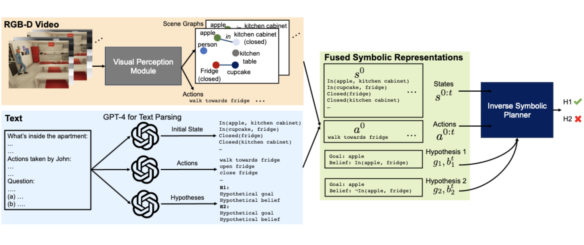

#  MMToM-QA: Multimodal Theory of Mind Question Answering
{: .text-center }

    

<!-- ## Introduction
We propose Bayesian Inverse Planning Accelerated by Language Models (BIP-ALM), a novel method to engineer multimodal Theory of Mind. This method: -->

<!-- 
 -->
  We propose Bayesian Inverse Planning Accelerated by Language Models (BIP-ALM), a novel method to engineer multimodal Theory of Mind.

