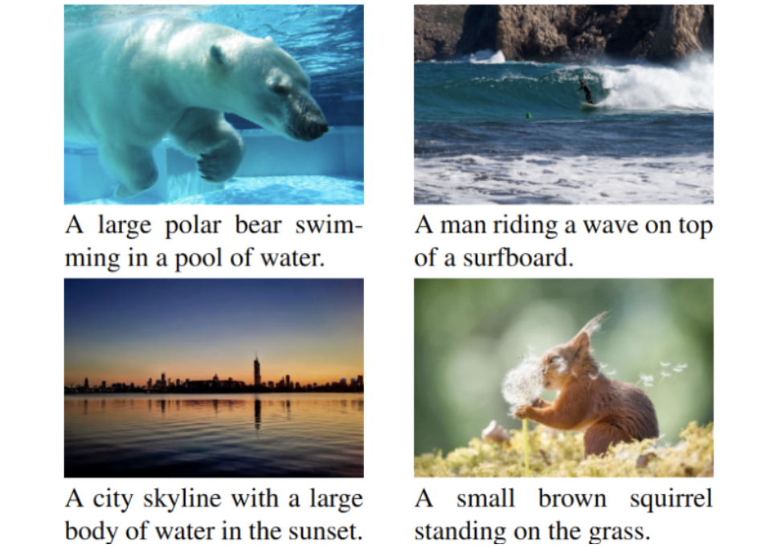

<head>
  <!-- Meta Description Tag -->
  <meta name="description" content="Projects by Chuanyang Jin.">

  

  

  
</head>

<!--  -->

 
  

    
  

  

    <b>Fast Diffusion Transformers</b> 
    <em>DiT models with 2x speedup and 60% less memory, 600+ GitHub Stars.</em> 
    <a href="https://github.com/chuanyangjin/fast-DiT">code</a>
  

 
  

    
  

  

    <b>The Cultural Psychology of Large Language Models: Is ChatGPT a Holistic or Analytic Thinker?</b> 
    <em>We probe the cultural cognitive traits of ChatGPT.</em> 
    Authors: <b>Chuanyang Jin</b>, Songyang Zhang, Tianmin Shu, Zhihan Cui 
    <a href="https://arxiv.org/abs/2308.14242">paper</a>
  

 
  

    
  

  

    <b>Self-Supervised Image Captioning with CLIP</b> 
    <em>Presented at the Self-Supervised Learning Workshop, NeurIPS 2023.</em> 
    Author: <b>Chuanyang Jin</b> 
    <a href="https://arxiv.org/abs/2306.15111">paper</a>
  

 
  

    
  

  

    <b>AutoCorp: A Fully Autonomous Company</b> 
    <em>LLM-driven autonomous company, 100K+ Twitter views.</em> 
    NYC GPT/LLM Hackathon 2023 
    <a href="/autocorp">project</a> / 
    <a href="https://twitter.com/minafahmi_/status/1650861037737091083">tweet</a> / 
    <a href="https://github.com/Czechh/chatdtc">code</a>
  

 
  

    
  

  

    <b>Social Platform for Recording and Sharing Emotions</b> 
    <em>We help you out of loneliness. You have the world's resonance.</em> 
    HackNYU 2022 
    <a href="https://devpost.com/software/em-k3gf5b">project</a> / 
    <a href="https://github.com/chuanyangjin/em">code</a>
  

 
  

    
  

  

    <b>Asteroid Mining and the Promise of Global Prosperity</b> 
    <em>“Do not go gentle into that good night.”</em> 
    MAA Award (Top 5/27205) and <a href="https://contest.comap.com/undergraduate/contests/mcm/contests/2022/results/2022_COMAP-Scholarship-Press-Release.pdf">COMAP Scholarship</a> ($10,000), 
    Mathematical Contest in Modeling 2022 
    <a href="/assets/reports/ICM_Report.pdf">report</a>
  

 
  

    
  

  

    <b>Gene Mutation Detection System</b> 
    <em>Our system was adopted by leading hospitals.</em> 
    <a href="http://www.yau-awards.com/lists-winnerslist.html">Bronze Medal</a> (Top 5/500, $10,000), 
    Shing-Tung Yau Computer Science Award 2019 
    <a href="https://oss.linstitute.net/wechatimg/2019/12/qiuchengtong2019combronze3.pdf">report</a> /
    <a href="https://drive.google.com/file/d/1Zdp33tiYmoppAdzMCOH_P44jzu6V9yW-/view?usp=sharing">demo</a> / 
    <a href="/assets/slides/Yau_Gene_Mutation_Detection.pdf">slides</a>
  

You can also visit my [project page](/projects) to view the projects I completed during my undergrad and high school years. A mountain of gratitude to those who have kindly mentored and inspired me with their vision and passion!