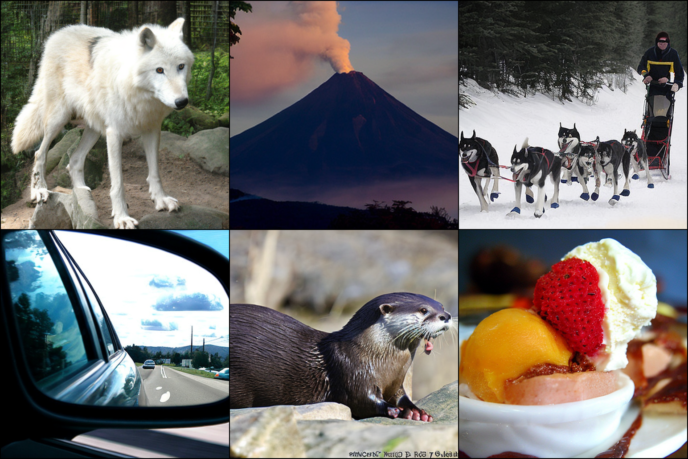
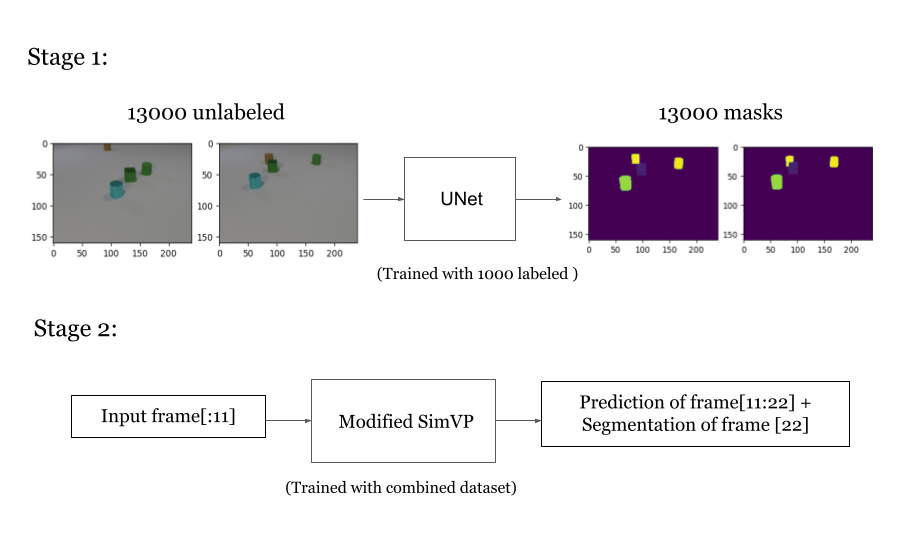
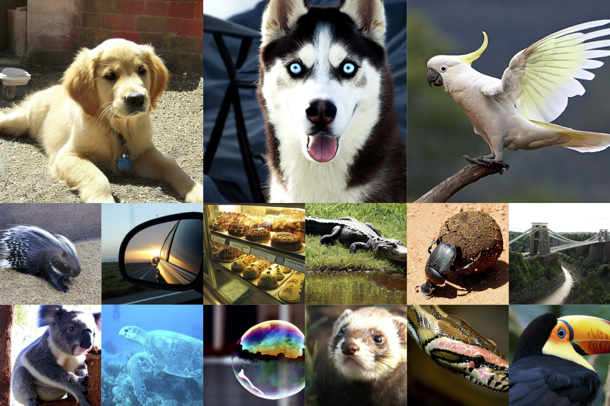
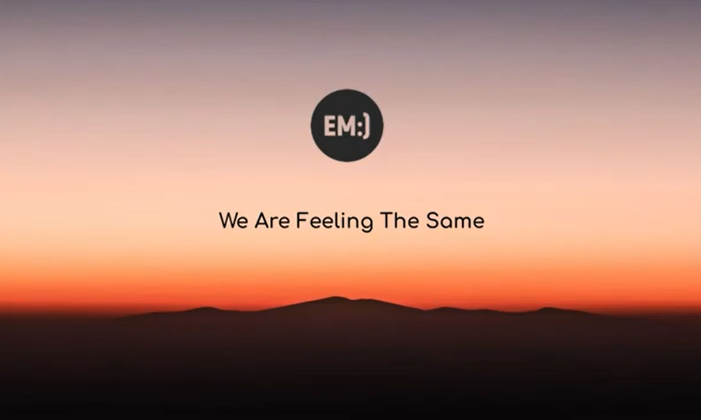
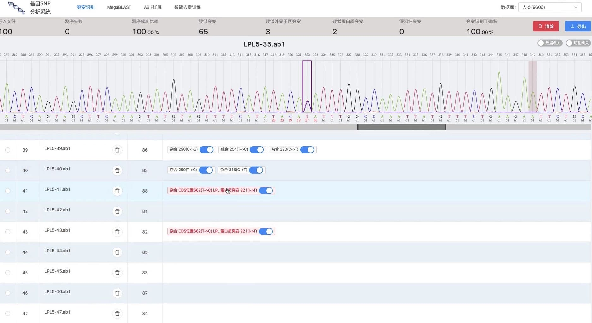

 
  

    
  

  

    <b>Class Embedding Patterns in Classifier-Free Diffusion</b> 
    Chuanyang Jin, Peiqi Liu, Zixuan Dong, Chang Liu 
    <a href="/assets/reports/Class_Embedding_Patterns_in_Classifier-Free_Diffusion.pdf">report</a> / 
    <a href="/assets/slides/Class_Embedding_Patterns_in_Classifier-Free_Diffusion.pdf">slides</a> / 
    <a href="https://github.com/chuanyangjin/DDPM-with-Class-Embeddings">code</a>
  

 
  

    
  

  

    <b>Efficient Video Prediction and Segmentation with Sparse Labeled Data</b> 
    Peiqi Liu, Samuel Zhong, Chuanyang Jin 
    <a href="/assets/reports/Multi_Stage_Transfer_Learning_for_Efficient_Video_Prediction_and_Segmentation_with_Sparse_Labeled_Data.pdf">report</a> / 
    <a href="/assets/slides/Multi_Stage_Transfer_Learning_for_Efficient_Video_Prediction_and_Segmentation_with_Sparse_Labeled_Data.pdf">slides</a> / 
    <a href="https://github.com/leo20021210/SimVP">code</a>
  

 
  

    
  

  

    <b>Optimizing Diffusion Transformers</b> 
    Chuanyang Jin, Saining Xie  
    <a href="/assets/reports/Optimizing_Diffusion_Transformers.pdf">report</a> / 
    <a href="https://github.com/chuanyangjin/fast-DiT">code</a>
  

 
  

    
  

  

    <b>AutoCorp: A Fully Autonomous Company</b> 
    Competition: NYC GPT/LLM Hackathon 2023 
    <a href="/autocorp">demo</a> / 
    <a href="https://twitter.com/minafahmi_/status/1650861037737091083">tweet</a> / 
    <a href="https://github.com/Czechh/chatdtc">code</a>
  

 
  

    
  

  

    <b>Learn & Link</b> 
    Competition: Hack GPT 2023 
    <a href="https://devpost.com/software/learn-and-link">demo</a> / 
    <a href="https://github.com/chuanyangjin/Learn_and_Link">code</a>
  

 
  

    
  

  

    <b>Recommendation System for E-commerce Retailer</b> 
    Competition: NYU x Peak Datathon 2022 
    <a href="/assets/slides/Recommendation_System_for_Olist_E-commerce_Retailer.pdf">slides</a> / 
    <a href="https://github.com/chuanyangjin/Peak-Datathon">code</a>
  

 
  

    
  

  

    <b>Social Platform for Recording and Sharing Emotions</b> 
    Competition: HackNYU 2022 
    <a href="https://devpost.com/software/em-k3gf5b">demo</a> / 
    <a href="https://github.com/chuanyangjin/em">code</a>
  

 
  

    
  

  

    <b>Promoting Global Equity through Asteroid Mining</b> 
    Competition: Interdisciplinary Contest in Modeling 2022 
    Awards: Finalist & MAA Award & COMAP Scholarship (Top 4/27205) 
    <a href="/assets/reports/ICM_Report.pdf">report</a>
  

 
  

    
  

  

    <b>Gene Mutation Detection System</b> 
    Competition: Shing-Tung Yau Science Award 2019 
    Award: International Bronze Award (Top 3/500) 
    <a href="https://drive.google.com/file/d/1Zdp33tiYmoppAdzMCOH_P44jzu6V9yW-/view?usp=sharing">demo</a> / 
    <a href="/assets/slides/Yau_Gene_Mutation_Detection.pdf">slides</a>
  

Course Projects
------
***

+ [Energy-Based Models for Structured Prediction](https://github.com/chuanyangjin/NYU-Course-Projects/blob/master/Energy-Based%20Models%20for%20Structured%20Prediction/Energy-Based%20Models%20for%20Structured%20Prediction.ipynb)

+ [Parallel Data Encoding](https://github.com/chuanyangjin/NYU-Course-Projects/tree/master/Parallel%20Data%20Encoding)

+ [Robot Intelligence](https://github.com/chuanyangjin/NYU-Course-Projects/tree/master/Robot%20Intelligence)

+ [Transformer-based German-English Translator](https://github.com/chuanyangjin/NYU-Course-Projects/tree/master/Transformer-based%20German-English%20Translator)

+ [Unix Shell Implementation](https://github.com/chuanyangjin/NYU-Course-Projects/tree/master/Unix%20Shell%20Implementation)

+ [Vision Transformer for Small-Size Datasets](https://github.com/chuanyangjin/NYU-Course-Projects/tree/master/Vision%20Transformer%20for%20Small-Size%20Datasets)

+ [YOLO Object Detection](https://github.com/chuanyangjin/NYU-Course-Projects/blob/master/YOLO%20Object%20Detection/YOLO%20Object%20Detection.ipynb)

And 8 others... [see more](https://github.com/chuanyangjin/NYU-Course-Projects)