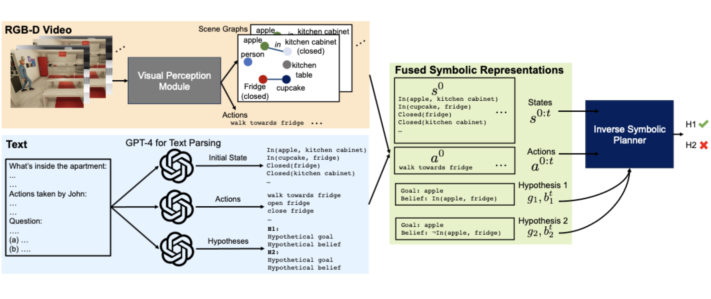
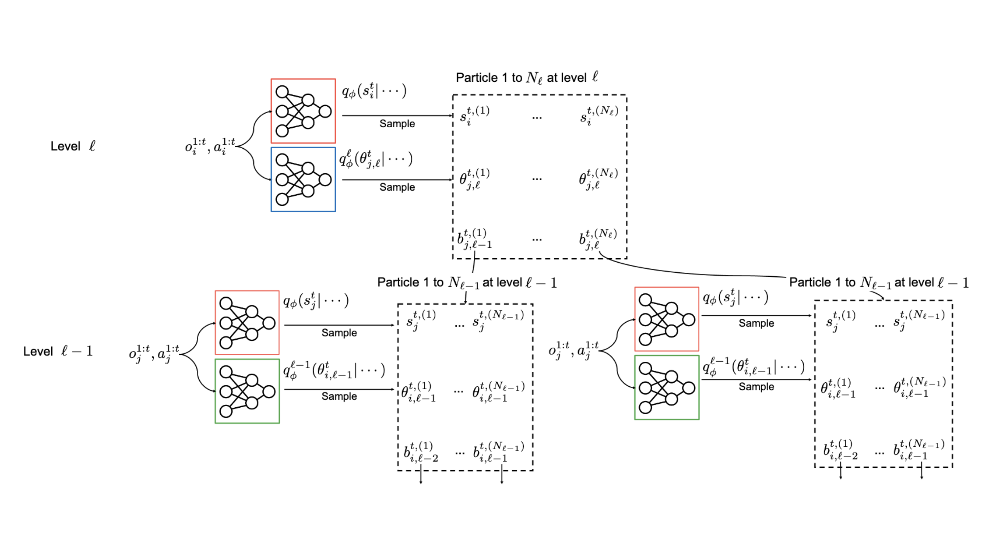
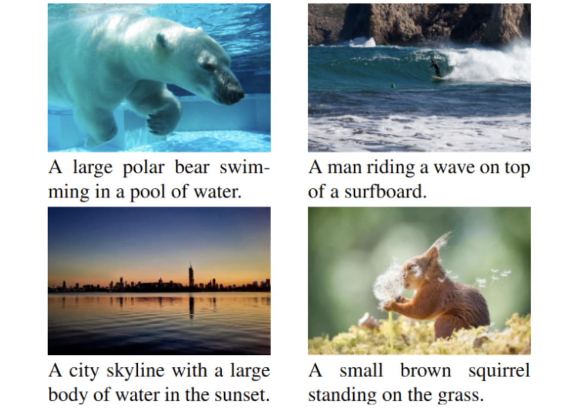
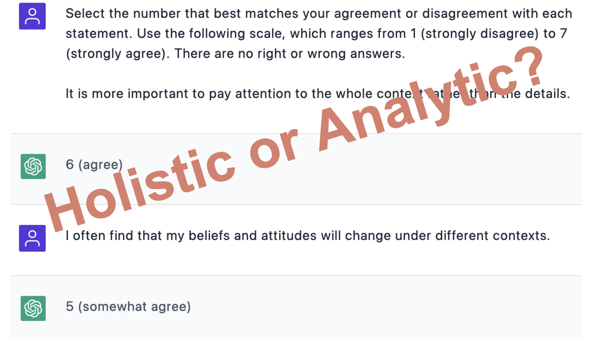

 
  

    
  

  

    <b>MMToM-QA: Multimodal Theory of Mind Question Answering</b> 
    <b>Chuanyang Jin</b>,
    <a href="https://www.linkedin.com/in/yutong-wu-a5a575209/">Yutong Wu</a>,
    <a href="https://www.linkedin.com/in/jingcao26/">Jing Cao</a>,
    <a href="https://szxiangjn.github.io/">Jiannan Xiang</a>,
    <a href="https://yenlingkuo.com/">Yen-Ling Kuo</a>,
    <a href="http://zhiting.ucsd.edu/">Zhiting Hu</a>,
    <a href="https://www.tomerullman.org/">Tomer Ullman</a>,
    <a href="https://groups.csail.mit.edu/vision/torralbalab/">Antonio Torralba</a>,
    <a href="http://web.mit.edu/cocosci/josh.html">Joshua Tenenbaum</a> and 
    <a href="https://www.tshu.io/">Tianmin Shu</a> 
    <i>Under Review</i>  
  

 
  

    
  

  

    <b>Neural Amortized Inference for Nested Multi-agent Reasoning</b> 
    <a href="https://www.linkedin.com/in/kunal-jha-5728b8182/">Kunal Jha</a>, 
    <a href="https://www.tuananhle.co.uk/">Tuan Anh Le</a>, 
    <b>Chuanyang Jin</b>, 
    <a href="https://yenlingkuo.com/">Yen-Ling Kuo</a>, 
    <a href="http://web.mit.edu/cocosci/josh.html">Joshua Tenenbaum</a> and 
    <a href="https://www.tshu.io/">Tianmin Shu</a> 
    <i>Under Review</i> | 
    Oral Presentation at AAAI Summer Symposium, 2023 
    <a href="https://arxiv.org/abs/2308.11071">paper</a> / 
    <a href="/assets/slides/AAAI_Nested_Reasoning.pdf">slides</a>
  

 
  

    
  

  

    <b>Semi-Supervised Image Captioning with CLIP</b> 
    <b>Chuanyang Jin</b> 
    <i>Under Review</i> 
    <a href="https://arxiv.org/abs/2306.15111">paper</a>
  

 
  

    
  

  

    <b>The Cultural Psychology of Large Language Models: Is ChatGPT a Holistic or Analytic Thinker?</b> 
    <b>Chuanyang Jin</b>, 
    <a href="https://www.linkedin.com/in/songyang-zhang-306956185/">Songyang Zhang</a>, 
    <a href="https://www.tshu.io/">Tianmin Shu</a> and 
    <a href="https://zhihan-cui.weebly.com/">Zhihan Cui</a> 
    <i>Under Review</i> 
    <a href="https://arxiv.org/abs/2308.14242">paper</a>
  

 

In progress:

+ Watch-Talk-And-Help: Building Cooperative Embodied Agents with Large Language Models

+ The Composition of Nuclear Speckle and Relating Functions