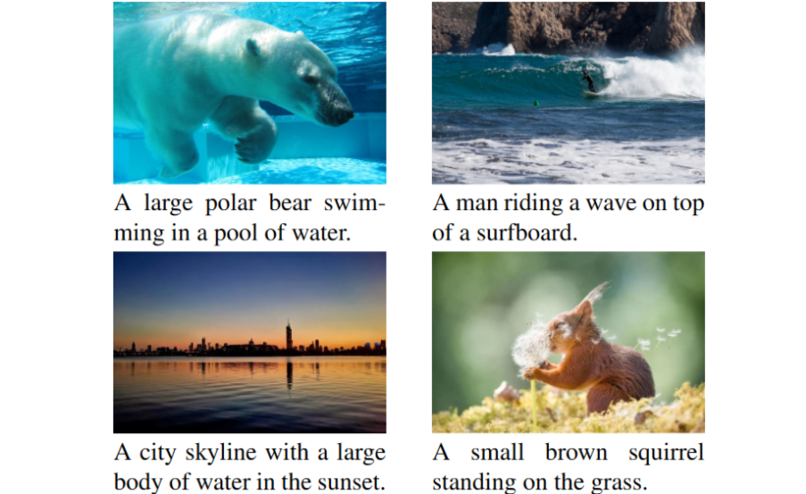
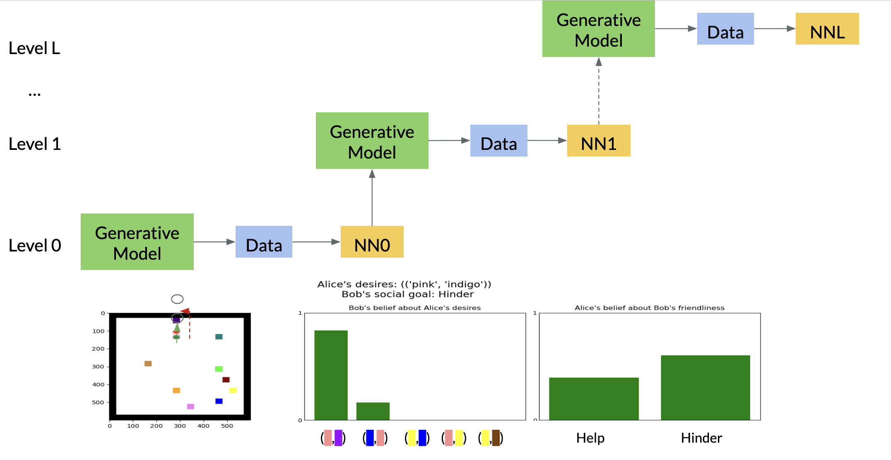

<!--

 
  
  <b>Semi-Supervised Image Captioning with CLIP</b> 
  <b>Chuanyang Jin</b> 
  <i>Under Review</i> 
  <a href="https://arxiv.org/abs/2306.15111">paper</a>

 
  
  <b>Neural Amortized Inference for Nested Multi-agent Reasoning</b> 
  Kunal Jha, Tuan Anh Le, <b>Chuanyang Jin</b>, Yen-Ling Kuo, Joshua Tenenbaum and Tianmin Shu 
  <i>Under Review</i> | 
  Oral Presentation at AAAI Symposium 2023 
  <a href="https://chuanyangjin.github.io/assets/slides/AAAI_Nested_Reasoning.pdf">slides</a>

-->

 
  

    
  

  

    <b>Semi-Supervised Image Captioning with CLIP</b> 
    <b>Chuanyang Jin</b> 
    <i>Under Review</i> 
    <a href="https://arxiv.org/abs/2306.15111">paper</a>
  

 
  

    
  

  

    <b>Neural Amortized Inference for Nested Multi-agent Reasoning</b> 
    Kunal Jha, 
    <a href="https://www.tuananhle.co.uk/">Tuan Anh Le</a>, 
    <b>Chuanyang Jin</b>, 
    <a href="https://yenlingkuo.com/">Yen-Ling Kuo</a>, 
    <a href="http://web.mit.edu/cocosci/josh.html">Joshua Tenenbaum</a> and 
    <a href="https://www.tshu.io/">Tianmin Shu</a> 
    <i>Under Review</i> | 
    Oral Presentation at AAAI Symposium 2023 
    <a href="https://chuanyangjin.github.io/assets/slides/AAAI_Nested_Reasoning.pdf">slides</a>
  

<!--

 
  
  

    <b>Semi-Supervised Image Captioning with CLIP</b> 
    <b>Chuanyang Jin</b> 
    <i>Under Review</i> 
    <a href="https://arxiv.org/abs/2306.15111">paper</a>
  

 
  
  

    <b>Neural Amortized Inference for Nested Multi-agent Reasoning</b> 
    Kunal Jha, Tuan Anh Le, <b>Chuanyang Jin</b>, Yen-Ling Kuo, Joshua Tenenbaum and Tianmin Shu 
    <i>Under Review</i> | 
    Oral Presentation at AAAI Symposium 2023 
    <a href="https://chuanyangjin.github.io/assets/slides/AAAI_Nested_Reasoning.pdf">slides</a>
  

 
<table style="border-collapse: collapse; border: none;">
  <tr>
    <td style="padding: 20px; width: 20%; vertical-align: middle; border: none;">
      
    </td>
    <td style="width: 75%; vertical-align: middle; border: none;">
      <b>Semi-Supervised Image Captioning with CLIP</b> 
      <b>Chuanyang Jin</b> 
      <i>Under Review</i> 
      <a href="https://arxiv.org/abs/2306.15111">paper</a>
    </td>
  </tr>
</table>

<table style="border-collapse: collapse; border: none;">
  <tr>
    <td style="padding: 20px; width: 20%; vertical-align: middle; border: none;">
      
    </td>
    <td style="width: 75%; vertical-align: middle; border: none;">
      <b>Neural Amortized Inference for Nested Multi-agent Reasoning</b> 
      Kunal Jha, Tuan Anh Le, <b>Chuanyang Jin</b>, Yen-Ling Kuo, Joshua Tenenbaum and Tianmin Shu 
      <i>Under Review</i> | 
      Oral Presentation at AAAI Symposium 2023 
      <a href="https://chuanyangjin.github.io/assets/slides/AAAI_Nested_Reasoning.pdf">slides</a>
    </td>
  </tr>
</table>
-->